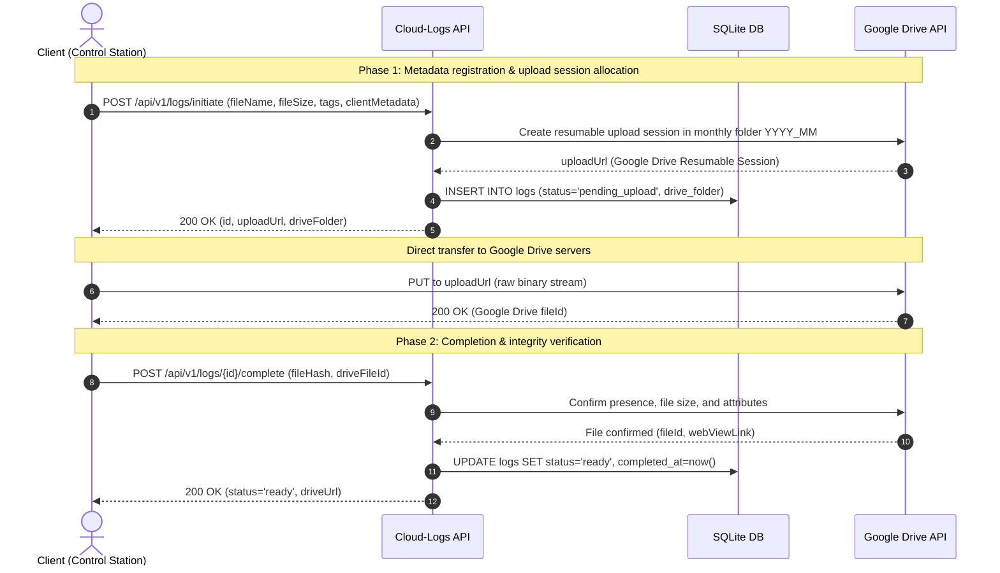
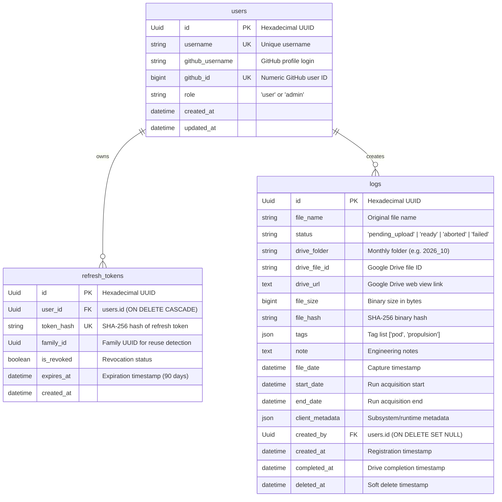

# System Architecture - Cloud Logs (Hyperloop UPV)

Technical architecture documentation for the centralized telemetry and diagnostic log catalog service of the **Control Station**.

---

## 1. Overview and Core Objectives

**Cloud Logs** centralizes, indexes, and enables fast querying across telemetry archives and diagnostic logs generated by the pod.

### Fundamental Design Principles
1. **Decoupled Binary Storage and Metadata Separation**:
   - The API server **never buffers, stores, or processes large compressed archives (ZIP files) on local disk**.
   - Mass storage is offloaded to **Google Drive**, organized into monthly subfolders (`YYYY_MM`).
2. **Two-Phase Upload Protocol**:
   - **Phase 1 (Initiate)**: The client registers metadata and requests a pre-authenticated resumable upload session from Google Drive.
   - **Phase 2 (Verification)**: The client notifies transfer completion; the API server verifies presence and file size in Google Drive and transitions the record to `ready`.
3. **Lightweight & Portable Async Persistence (SQLite)**:
   - Local database engine powered by SQLite (`aiosqlite`) and SQLAlchemy 2.0 in async mode (WAL mode enabled).
   - Automatic schema and index provisioning on application startup without external database daemons.
   - Standard data types (`Uuid`, `JSON`, `DateTime`).
4. **Flat Sessionless Catalog**:
   - Every telemetry log is an independent catalog entry taggable (`tags`) and searchable by author, time window, and subsystem metadata (`client_metadata`).
5. **Role-Based Access Control (RBAC) & Security**:
   - Authentication via GitHub OAuth 2.0 (with optional organization membership validation).
   - Short-lived JWT access tokens (15 min) and rotating refresh tokens with reuse detection (90 days).
   - System service access via **Master API Key** (`X-API-Key` or `Bearer <key>`).
   - Simplified two-tier role model:
     - `user`: Default role granted automatically to all authenticated members (uploading, listing, searching, downloading, and editing logs).
     - `admin`: Administrators with advanced permissions (internal metadata searches, maintenance cleanup execution, and member role assignment). Promoted by an existing admin or Master Key.

---

## 2. Two-Phase Upload Protocol

Because telemetry files are large (compressed archives ranging from tens to hundreds of megabytes), clients stream data directly to Google Drive infrastructure via resumable upload URLs without congesting the API server's network bandwidth.



---

## 3. Database Schema (SQLite)

The data model is organized into three primary tables managed by SQLAlchemy 2.0:



### Performance Indices
- `users`: `username` (UK), `github_id` (UK).
- `refresh_tokens`: `token_hash` (UK), `family_id`.
- `logs`: `status`, `drive_folder`, `file_hash`, `created_at`, `start_date`.

### Soft Deletion Strategy
Log records are never physically removed during normal operation. A soft delete updates `deleted_at = datetime.now(timezone.utc)`. All catalog queries, statistics aggregations, and downloads automatically apply `Log.deleted_at.is_(None)`.

---

## 4. Security & Role-Based Access Control (RBAC)

### Authentication Methods
1. **GitHub OAuth 2.0**:
   - `GET /api/v1/auth/login`: Redirects to GitHub with a cryptographically secure anti-CSRF state token.
   - `GET /api/v1/auth/callback`: Exchanges temporary authorization code for an access token, validates organization membership (if configured), creates/updates member record, and issues tokens.
2. **JWT & Rotating Refresh Tokens**:
   - **Access Token**: 15-minute JWT signed via HS256 (`Bearer <token>`).
   - **Refresh Token**: 48-byte URL-safe string stored solely as a SHA-256 hash. Delivered via an `HttpOnly`, `SameSite=Lax` cookie.
   - **Reuse Detection**: Implements token families (`family_id`). If an already-rotated token is submitted again, **all tokens in that family are immediately revoked**.
3. **Master API Key**:
   - High-privilege service key for on-board pod computers, CI/CD pipelines, and disaster recovery.
   - Transmitted via `X-API-Key: <key>` or `Authorization: Bearer <key>`.
   - Verified in constant time via `hmac.compare_digest` with audit warning logs recording client IP and User-Agent.

### Permission Matrix

| Endpoint | Method | User (Standard) | Admin | Master Key |
| :--- | :--- | :---: | :---: | :---: |
| `/api/v1/logs` (Search/List with Sorting) | `GET` | ✓ | ✓ | ✓ |
| `/api/v1/logs?metadataQuery=...` (Internal Metadata Query) | `GET` | ☓ | ✓ | ✓ |
| `/api/v1/logs/stats` (Catalog Aggregations) | `GET` | ✓ | ✓ | ✓ |
| `/api/v1/logs/{id}` (Detail) | `GET` | ✓ | ✓ | ✓ |
| `/api/v1/logs/{id}/download` (Direct Download 307) | `GET` | ✓ | ✓ | ✓ |
| `/api/v1/logs/tags` (Unique Tags) | `GET` | ✓ | ✓ | ✓ |
| `/api/v1/logs/initiate` (Start Upload) | `POST` | ✓ | ✓ | ✓ |
| `/api/v1/logs/{id}/complete` (Verify & Finalize) | `POST` | ✓ | ✓ | ✓ |
| `/api/v1/logs/{id}/abort` (Cancel Upload) | `POST` | ✓ | ✓ | ✓ |
| `/api/v1/logs/{id}` (Update Metadata) | `PATCH` | ✓ | ✓ | ✓ |
| `/api/v1/logs/{id}` (Soft Delete) | `DELETE` | ✓ | ✓ | ✓ |
| `/api/v1/logs/cleanup` (Catalog Maintenance GC) | `POST` | ☓ | ✓ | ✓ |
| `/api/v1/users` (List Registered Members) | `GET` | ☓ | ✓ | ✓ |
| `/api/v1/users/{id}/role` (Assign Admin/User Role) | `PATCH` | ☓ | ✓ | ✓ |
| `/api/v1/users/me` / `/api/v1/auth/me` | `GET` | ✓ | ✓ | ✓ |

---

## 5. Google Drive Storage Organization

Telemetry ZIP archives are distributed into a monthly hierarchy under the root folder:
```text
Google Drive Root Folder (GDRIVE_ROOT_FOLDER_ID)
├── 2026_09/
│   ├── run_001_bms_telemetry.zip
│   └── bench_inverter_run.zip
├── 2026_10/
│   ├── run_002_track_pod_v3.zip
│   └── sensor_diagnostic_oct.zip
└── 2026_11/
```

- **Simulation Mode**: Setting `GDRIVE_SIMULATION_MODE=true` allows full local testing without Google Cloud credentials. If credentials are not configured and simulation mode is disabled, the service rejects operations requiring Google Drive with `503 Service Unavailable`.
- **Google Workspace Shared Drive Requirement**: Google Cloud Service Accounts have 0 MB personal storage quota. Uploading to a personal Google account ("My Drive") fails with `403 storageQuotaExceeded`. In production, the root folder must reside within a **Google Workspace Shared Drive**, granting the Service Account *Content Manager* or *Contributor* access. Shared Drives pool organizational storage, bypassing individual quota limits.

---

## 6. Background Maintenance Worker & Retention Policy

To keep the local SQLite database compact without external cron daemons, the service includes an asynchronous worker running within FastAPI's `lifespan`:

- **Execution Interval**: Weekly (`CLEANUP_INTERVAL_HOURS=168`, 7 days by default).
- **Cleanup Policy**:
  - Affects **only uncompleted logs** (`pending_upload`, `aborted`, `failed`) older than 30 days (`retention_days >= 30`).
  - Stale uncompleted records are soft-deleted (`deleted_at = now()`).
- **Archive Inviolability Guarantee**: Telemetry logs in `ready` status (transfers verified in Google Drive) are **NEVER deleted or modified automatically**, ensuring indefinite preservation.
- **Manual Trigger**:
  - `POST /api/v1/logs/cleanup` (restricted to `admin` or Master Key).
  - Parameters: `retentionDays` (default: 30), `dryRun` (preview without updates), and `purgeSoftDeleted` (hard purge of records soft-deleted > 30 days ago).

---

## 7. Source Code Structure

```text
cloud-logs-tmp/
├── Dockerfile               # Docker image
├── docker-compose.yml       # Production orchestration
├── app/
│   ├── api/
│   │   └── v1/
│   │       ├── auth.py          # Authentication endpoints (OAuth, JWT, token rotation)
│   │       ├── logs.py          # Telemetry catalog endpoints
│   │       └── users.py         # Member profile and role management endpoints
│   ├── core/
│   │   ├── cleanup.py       # Weekly background worker and retention routine
│   │   ├── gdrive.py        # Google Drive service
│   │   ├── github.py        # GitHub OAuth validator
│   │   └── security.py      # Token hashing, Master API Key verification, and JWT
│   ├── db/
│   │   ├── base.py          # SQLAlchemy DeclarativeBase
│   │   ├── engine.py        # SQLite engine configuration
│   │   └── session.py       # Database session dependency provider
│   ├── models/
│   │   ├── auth.py          # RefreshToken model
│   │   ├── log.py           # Log catalog model
│   │   └── user.py          # User model
│   ├── schemas/
│   │   ├── auth.py          # Pydantic schemas for authentication
│   │   ├── base.py          # CamelModel (camelCase serialization base)
│   │   └── log.py           # Pydantic schemas for logs
│   ├── config.py            # Settings management powered by pydantic-settings
│   ├── dependencies.py      # Dependency injection for auth and RBAC enforcement
│   └── main.py              # FastAPI instance, CORS, lifespan, and docs configuration
├── docs/
│   ├── ARCHITECTURE.md      # This detailed architecture documentation
│   └── API_FRONTEND.md      # API integration guide for frontend and client developers
├── tests/
│   ├── test_auth.py         # Unit tests for security, tokens, and auth endpoints
│   ├── test_gdrive.py       # Unit tests for Google Drive service and monthly folders
│   ├── test_logs.py         # Unit tests for log catalog controllers
│   ├── test_sqlite_integration.py # End-to-end integration tests against SQLite
│   └── test_users.py        # Unit tests for user profile and role management
├── requirements.txt         # Python dependencies
└── pytest.ini               # Pytest test runner configuration
```
